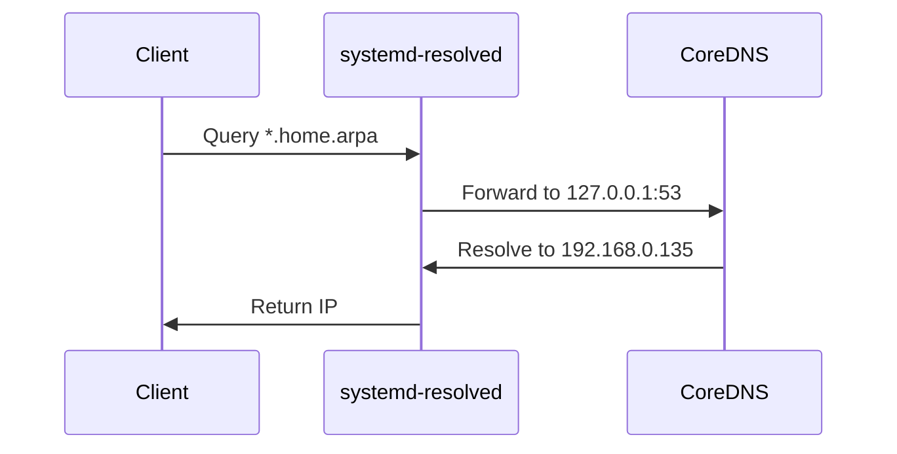

# 🏠 Home Server – Ubuntu 25, LAN Dev & Services Stack Docker

## Project

This project documents turning an **old laptop** into a **local Ubuntu server** with:

- Docker-based services
- Local DNS
- HTTPS on LAN
- Reverse proxy
- Clean, debuggable architecture

Designed for **home / lab / dev use**, not public hosting.

## Repository and Structure

This repository contains a **self‑hosted home server stack** built with **Docker Compose**, **Traefik**, **CoreDNS**, and multiple services (Portainer, Nextcloud, n8n, Uptime Kuma, WireGuard, databases).

The stack is intentionally **split into multiple Compose files** so each service can be brought up, debugged, and maintained independently.

```text
.
├── databases/
│   ├── docker-compose.mssql.yml
│   └── docker-compose.postgres.yml
│
├── traefik/
│   ├── dynamic/
│   │   └── tls.yml               # Dynamic TLS config
│   ├── homearpaCA.pem            # Local CA certificate
│   └── traefik.yml               # Static Traefik config
│
├── Corefile                      # CoreDNS configuration
├── .env                          # Shared environment variables
├── backup.sh                     # Backup helper script
│
├── docker-compose.dns.yml        # CoreDNS
├── docker-compose.traefik.yml    # Traefik
├── docker-compose.portainer.yml
├── docker-compose.nextcloud.yml
├── docker-compose.n8n.yml
├── docker-compose.kuma.yml
├── docker-compose.wireguard.yml
│
├── wg-home.conf                  # WireGuard client config
└── README.md
```

---

## 🧱 Architecture Overview

- **Docker Desktop / Docker Engine ≥ 29**
- **Traefik** as reverse proxy & TLS terminator
- **CoreDNS** for `.home.arpa` local DNS
- **Internal Docker network** (no public ports for apps)
- **HTTPS everywhere** using a local CA
- **Services exposed only via Traefik**

```mermaid
graph TD
    A[Clients<br/>(Windows/Linux/Android)] --> B[DNS Query<br/>(*.home.arpa)]
    B --> C[CoreDNS<br/>(Resolves to 192.168.0.135)]
    C --> D[Traefik<br/>(Reverse Proxy & HTTPS)]
    D --> E[Portainer<br/>(portainer.home.arpa)]
    D --> F[Nextcloud<br/>(nextcloud.home.arpa)]
    D --> G[n8n<br/>(n8n.home.arpa)]
    D --> H[Uptime Kuma<br/>(status.home.arpa)]
    D --> I[WireGuard<br/>(VPN Access)]
```

## 🎯 Goals

- LAN-only server with **static IP**
- HTTPS for local domains
- No exposed app ports
- Docker-first workflow
- Easy to debug & extend
- Works on low‑resource hardware

## 🖥️ Server Environment


| Item     | Value                               |
| -------- | ----------------------------------- |
| OS       | Ubuntu 24.04                        |
| Host IP  | `192.168.0.135` (static via router) |
| Timezone | `Asia/Karachi`                      |
| User     | `admin` (non-root)                  |
| Docker   | Engine 29.x                         |
| Compose  | v2 (no`version:` field)             |

## 👤 User & SSH Setup

### Create non-root admin user

```bash
sudo adduser admin
sudo usermod -aG sudo,docker admin
```

## SSH access

```bash
    ssh admin@192.168.0.135
```

Root login should remain disabled.

## 🐳 Docker Strategy

1. Docker Compose v2
2. Multiple compose files, one service at a time
3. One shared network (see Startup Order for creation)

##  Local Domains


| Service     | Domain              |
| ----------- | ------------------- |
| Traefik     | traefik.home.arpa   |
| Portainer   | portainer.home.arpa |
| Nextcloud   | nextcloud.home.arpa |
| n8n         | n8n.home.arpa       |
| Uptime Kuma | status.home.arpa    |

## 🔐 TLS Strategy (LAN HTTPS)

- mkcert used for local certificates
- No Let’s Encrypt (LAN only)
- Traefik loads certs from files

### Directory

```
data/traefik/
├── cert.pem
├── key.pem
├── traefik.yml
└── tls.yml
```

## 📜 Traefik Configuration

```traefik.yml```

```yml
entryPoints:
  web:
    address: ":80"
  websecure:
    address: ":443"

providers:
  docker:
    exposedByDefault: false
  file:
    directory: /certs
    watch: true

api:
  dashboard: true
  insecure: true
```

```tls.yml```

```yml
tls:
  certificates:
    - certFile: /certs/cert.pem
      keyFile: /certs/key.pem
```

```mermaid
flowchart TD
    A[Client Request<br/>(e.g., https://portainer.home.arpa)] --> B[EntryPoint<br/>(websecure:443)]
    B --> C[Providers<br/>(Docker + File)]
    C --> D[Router<br/>(Matches domain)]
    D --> E[Service<br/>(Portainer Container)]
    E --> F[Response<br/>(via Internal Network)]
```

## 🧭 CoreDNS (Local DNS)

Purpose
Resolve *.home.arpa

Avoid editing hosts files on every device

```Corefile```

```coredns
home.arpa:53 {
    hosts {
        192.168.0.135 portainer.home.arpa
        192.168.0.135 n8n.home.arpa
        192.168.0.135 nextcloud.home.arpa
        192.168.0.135 status.home.arpa
        192.168.0.135 traefik.home.arpa
        fallthrough
    }
}
```



## 🧠 systemd‑resolved Configuration

We did NOT disable systemd‑resolved.
It forwards .home.arpa to CoreDNS and uses public fallback DNS.

```/etc/systemd/resolved.conf```

```ini
[Resolve]
DNS=127.0.0.1
FallbackDNS=8.8.8.8 1.1.1.1
Domains=~home.arpa
DNSStubListener=yes

```

### Restart:

```sudo systemctl restart systemd-resolved```

### Verify:

```bash
resolvectl status
dig portainer.home.arpa
```

## 🚀 Startup Order (IMPORTANT)

```bash
docker network create proxy
docker compose -f docker-compose.coredns.yml up -d
docker compose -f docker-compose.traefik.yml up -d
docker compose -f docker-compose.portainer.yml up -d
docker compose -f docker-compose.nextcloud.yml up -d
docker compose -f docker-compose.n8n.yml up -d
docker compose -f docker-compose.kuma.yml up -d
docker compose -f docker-compose.wireguard.yml up -d
```

## 🔍 Debugging Rules

- ❌ Do NOT edit /etc/resolv.conf
- ❌ Do NOT expose app ports
- 404 = Traefik router issue
- Default cert = TLS not loaded
- DNS fails = CoreDNS or resolved

## ✅ Current Status

- Local DNS working
- HTTPS working on LAN
- Docker stack stable
- Modular & extendable

## 🛣️ Future Improvements

- Backups
- Resource limits
- Public domain (optional)
- Monitoring stack
- GitOps
