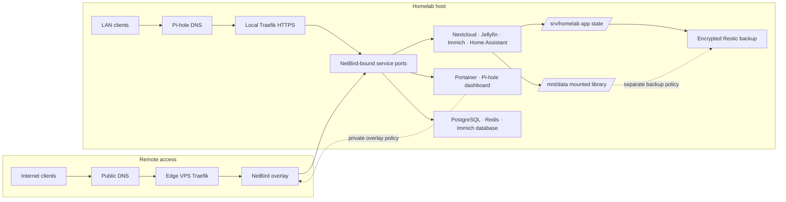
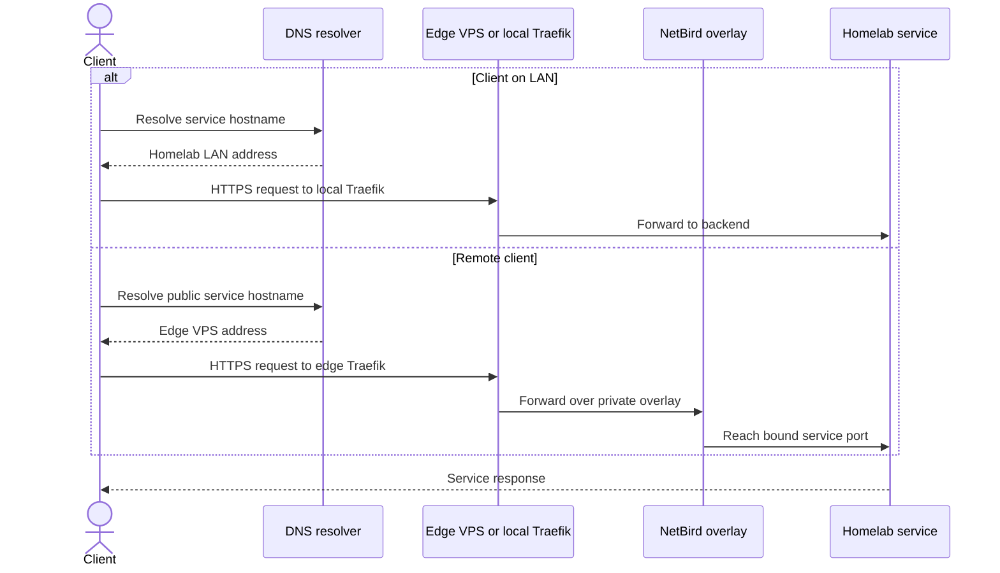
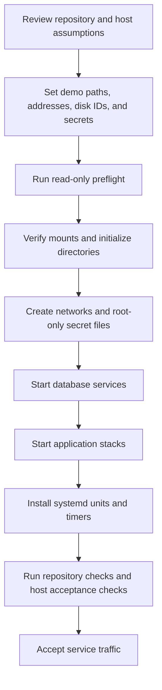

These diagrams describe the reference implementation. Addresses and hostnames in
the configuration are placeholders; review them before deployment.

## Infrastructure overview

The public DNS and edge path serves only the routes configured in the edge
overlay. Administrative services should remain behind the private overlay policy.
The diagram shows a possible data disk backup relationship; configure backup
coverage explicitly for each dataset.

## Request flow

## Deployment flow

Read the [setup guide](setup) for the command sequence and safety gates.
